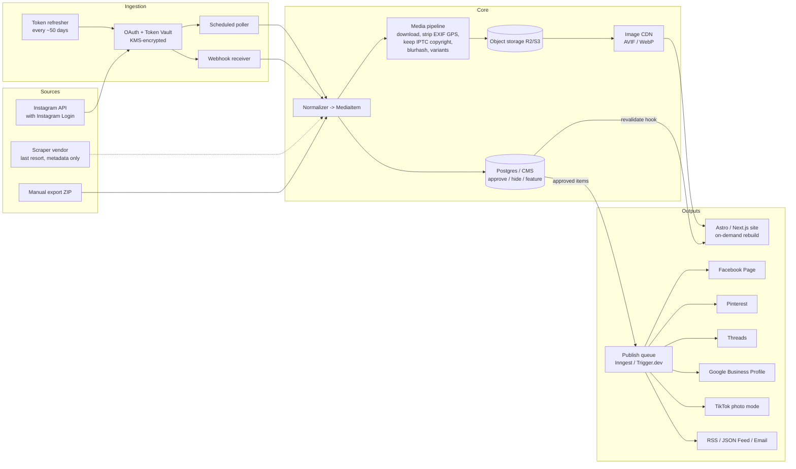

# Content Sync Strategy: Instagram-Sourced Websites for Small Local Businesses

**Pilot source:** [instagram.com/bovitzphotography](https://www.instagram.com/bovitzphotography)
**Audience:** a developer building and running websites for small local businesses (photographers, farms)
**Status:** strategy draft, October 2026

> **Account ownership is UNVERIFIED.** Instagram is blocked from the research environment, so the account's own posts, bio, and account type could not be inspected. Web search turns up several unrelated "Bovitz" photographers, including J. Scott Bovitz (LA adventure photographer, bovitz.com), a "BOVITZ PHOTOGRAPHY" Flickr account (535 photos), and Annie Bovitz / Bovara Media & Studios (real estate, drone and wedding, Raleigh). Do not assume any of them runs @bovitzphotography. Confirm ownership directly with the client before building anything. **The architecture below does not depend on which account it is.** It works for any Instagram Business or Creator account whose owner consents.

---

## 1. Executive Summary

**Recommendation:** start with consent and with official APIs. The photographer connects their own Instagram Business or Creator account through OAuth (Instagram API with Instagram Login). The platform ingests their media through the official API, stores originals under a signed content license, and treats the **website/CMS as the source of truth**. From there it publishes to other platforms in a hub-and-spoke model.

Scraping is a **documented last-resort fallback**. It covers logged-out, public metadata only, and has legal caveats (see §2 and §8). It is never the primary path.

### Recommended stack at a glance

| Layer | Default choice | Alternatives |
|---|---|---|
| Source access | Instagram API with Instagram Login (`instagram_business_*` scopes) | Graph API via Facebook Login; manual "Download your information" import |
| Runtime | TypeScript on Node 20+ | — |
| Web framework | **Astro** (static plus server islands) | Next.js App Router with ISR and on-demand revalidation |
| Content store | **Postgres (Supabase)** with editorial flags | Sanity or Payload CMS for richer editing |
| Object storage | Cloudflare R2 or S3 | Supabase Storage |
| Image delivery | Image CDN (Cloudflare Images, imgix, or Vercel/Netlify image optimization) serving AVIF/WebP | Self-hosted `sharp` plus a CDN |
| Jobs and queues | **Inngest** or **Trigger.dev** (serverless-friendly) | BullMQ with Redis on containers |
| Secrets | Envelope encryption with AWS KMS / GCP KMS | libsodium with a KMS-held key |
| Hosting | Vercel / Netlify / Cloudflare Pages | Fly.io / Render containers |
| Observability | Sentry, uptime checks, Postgres-backed sync metrics | Grafana / OpenTelemetry |

---

## 2. Source Reality Check

Instagram account types:

- **Personal.** No official API path since the **Instagram Basic Display API shut down on December 4, 2024**.
- **Creator** and **Business.** Eligible for the replacement APIs.

The client therefore has to switch to Creator or Business. It is free and reversible in the Instagram app.

The January 2025 scope rename introduced `instagram_business_basic`, `instagram_business_content_publish`, `instagram_business_manage_comments` and similar scopes. **Verify current scope names and review requirements in Meta's docs before you submit for app review.**

| Access path | Auth | Data available | Storage / reuse rights | Meta review | Risk |
|---|---|---|---|---|---|
| **Instagram API with Instagram Login** | OAuth by account owner; long-lived token (~60 days, refreshable) | Own media: id, caption, media_type, media_url, permalink, timestamp, children (carousels), thumbnail_url; profile basics; publishing | Allowed under Meta Platform Terms for the account owner's own content, and backed by your client license | Yes, app review for production; Business Verification may apply | **Low**. Recommended |
| **Graph API via Facebook Login** | OAuth through Facebook; IG professional account linked to a FB Page | Same media fields plus insights and hashtag search, depending on permissions | Same as above | Yes | Low. More setup (Page linkage) |
| **oEmbed** | App token plus "oEmbed Read" feature (status unsettled, see below) | Embed HTML and limited metadata per post URL | **Front-end embedding only**. Meta's docs forbid storing or repurposing the data | Historically yes | Low for embeds, but no use for a synced gallery |
| **Embed widgets (official embed code / Page-Plugin-style)** | None | Rendered iframe or blockquote | Display only; no data access | No | Low. Heavy JS, poor LCP, no SEO value |
| **Logged-out scraping** (self-built or a vendor such as Apify or Bright Data) | None | Whatever public HTML/JSON exposes, which changes often | **No license to the photos.** Copyright stays with the photographer | No | **High**. Brittle, ToS-gray, costs money |
| **Manual export** ("Download your information") | Account owner downloads a ZIP | Full-resolution media plus JSON metadata | Owner provides it directly. Cleanest rights position | No | Low. Manual, good for backfill |

**oEmbed status is unsettled.** WordPress-ecosystem reports describe a tokenless oEmbed change effective June 15, 2026 ([WP Mayor](https://wpmayor.com/meta-tokenless-oembed-wordpress/)). A Feedframer guide tested September 11, 2026 still reports that an app token and oEmbed Read review are required ([Feedframer](https://feedframer.com/guides/instagram-post-embed)). Check the [official oEmbed docs](https://developers.facebook.com/documentation/instagram-platform/oembed) at build time. Either way, oEmbed data may not be stored, so it cannot power the sync pipeline.

**Scraping legal note.** In *Meta v. Bright Data* (N.D. Cal., January 2024, Judge Chen), the court granted summary judgment for Bright Data on Meta's breach-of-contract claim, for **logged-out** scraping of public data. Limits of that ruling:

- It is a district court ruling, so it is **not binding precedent**.
- It does not cover logged-in scraping.
- It does not override copyright or privacy law.

This document gives **no guidance on evading rate limits, blocks, or bot detection**.

---

## 3. Reference Architecture



### 3.1 Ingestion

- **OAuth token store.** One row per tenant connection. The access token is encrypted with a per-tenant data key wrapped by KMS. Store `expires_at`, the granted scopes, and the IG user id.
- **Change detection.** Use both of the following, because webhook coverage for new-media events varies by API flavor. Verify which webhook fields your app can subscribe to.
  - Webhooks wherever the API supports them (comments and mentions, for example).
  - A **scheduled poll** of `/me/media` every 15–60 minutes per tenant, plus a nightly full reconcile to catch edits and deletes.
- **Long-lived token refresh.** Tokens last about 60 days. Refresh them on a schedule at about day 50, and alert at day 53 if the refresh fails.

```ts
// refresh-tokens.ts (Inngest cron), simplified
export const refreshTokens = inngest.createFunction(
  { id: "refresh-ig-tokens" },
  { cron: "0 3 * * *" },
  async ({ step }) => {
    const due = await step.run("find-due", () =>
      db.connection.findMany({ where: { provider: "instagram", expiresAt: { lt: addDays(new Date(), 10) } } })
    );
    for (const c of due) {
      await step.run(`refresh-${c.id}`, async () => {
        const token = await decrypt(c.tokenCiphertext, c.tenantId);
        // Endpoint and params per current Meta docs (refresh_access_token, grant_type=ig_refresh_token)
        const res = await fetch(`https://graph.instagram.com/refresh_access_token?grant_type=ig_refresh_token&access_token=${token}`);
        if (!res.ok) throw new Error(`refresh failed ${res.status}`); // retried, then alerts
        const { access_token, expires_in } = await res.json();
        await db.connection.update({
          where: { id: c.id },
          data: { tokenCiphertext: await encrypt(access_token, c.tenantId), expiresAt: addSeconds(new Date(), expires_in) },
        });
      });
    }
  }
);
```

### 3.2 Normalization: the canonical `MediaItem`

Every source (API, export, fallback) maps into one schema. All downstream code only ever sees `MediaItem`.

```ts
export type MediaType = "IMAGE" | "VIDEO" | "CAROUSEL_ALBUM";

export interface MediaAsset {
  sourceUrl?: string;          // ephemeral CDN URL from the source; never served directly
  storageKey: string;          // our object-storage key for the original
  width: number;
  height: number;
  mimeType: string;
  blurhash?: string;
  altText?: string;            // from source if present, else editor- or AI-suggested (human-approved)
}

export interface MediaItem {
  id: string;                  // our UUID
  tenantId: string;
  source: "instagram_api" | "instagram_export" | "fallback_scrape" | "manual_upload";
  sourceId: string;            // IG media id; (tenantId, source, sourceId) is unique
  permalink?: string;
  caption: string;
  hashtags: string[];          // parsed, lowercased, without '#'
  mediaType: MediaType;
  assets: MediaAsset[];        // 1 for IMAGE/VIDEO, n for CAROUSEL_ALBUM (children, in order)
  takenAt: string;             // ISO 8601 source timestamp
  ingestedAt: string;
  contentHash: string;         // hash of caption + asset ids, used for edit detection
  editorial: { status: "pending" | "approved" | "hidden"; featured: boolean; collections: string[] };
  license: { agreementId: string; credit: string };
  deletedAtSource?: string;
}
```

Also publish a JSON Schema generated from this type (with `zod-to-json-schema` or TypeBox) so external tools and feeds can validate against it.

### 3.3 Media pipeline

1. **Download originals right away.** Instagram `media_url` values are signed and they expire, so never hotlink them.
2. Store originals in **private** object storage (R2/S3) under `tenant/{id}/media/{sourceId}/{index}.{ext}`.
3. Process with `sharp`:
   - Strip EXIF GPS, camera serial, and other private EXIF.
   - **Keep IPTC/XMP copyright, creator, and credit fields.** If they are missing, inject them from the license record.
4. Generate a **blurhash/LQIP** placeholder and record the intrinsic dimensions, which prevents CLS.
5. Serve through an **image CDN** that negotiates AVIF/WebP and produces a responsive `srcset` (for example 480/768/1080/1600/2400 widths).
6. Video: store the original, generate a poster frame, and serve through a video host (Cloudflare Stream or Mux) or as MP4 with `preload="none"`.

### 3.4 Content store and editorial control

- **Postgres (Supabase)** with row-level security keyed on `tenant_id` is the default. Use **Sanity or Payload** when the client wants a friendly editing UI. Sync `MediaItem` into the CMS as documents, with the ingestion fields read-only.
- Editorial flags:
  - `approved`: nothing reaches the site until it is approved. Auto-approve is a per-tenant setting.
  - `hidden`
  - `featured`
  - `collections[]`

### 3.5 Site build

- **Astro** is the first choice: static-first, low JavaScript, and gallery pages pre-rendered.
- On ingest or approval, fire a **deploy hook** (Vercel/Netlify/Cloudflare) or call Next.js `revalidateTag('gallery:'+tenantId)` for on-demand ISR.
- Debounce rebuilds (for example a 2-minute window) so a carousel batch triggers one build, not ten.

---

## 4. Website Architecture for a Photography Business

| Area | Approach |
|---|---|
| **Gallery taxonomy** | Map hashtags and caption keywords to collections through a per-tenant rule table, for example `#wedding` or `#bride` → Weddings. Optionally, a vision model can suggest tags and alt text; a human approves every suggestion before it is published. |
| **Portfolio collections** | Curated, ordered sets (Weddings, Portraits, Real Estate, Events). `featured` items lead each one. |
| **Client proofing** | A separate, **private** area: expiring signed links, no indexing (`noindex`, auth), and favourites/selection. Keep it out of the Instagram sync and use direct uploads instead. Off-the-shelf tools (Pixieset or ShootProof style) are fine to link to instead. |
| **Booking / inquiry funnel** | Inquiry form (date, type, location, budget) → CRM or email, with Turnstile/hCaptcha spam protection, plus a calendar link. Every gallery page has a CTA. |
| **SEO** | `LocalBusiness` / `ProfessionalService` JSON-LD on home and contact (schema.org has no dedicated "Photographer" business type, so use `ProfessionalService` plus `Person` with `jobTitle`). `ImageObject` with `creator`, `copyrightNotice`, `license`, and `creditText` on images. **Image sitemap** entries. Descriptive filenames and alt text. One indexable page per collection. |
| **Performance budgets** | **LCP < 2.0 s**, **CLS < 0.05**, INP < 200 ms on mid-tier mobile. Preload the hero image, set explicit width and height, lazy-load below the fold, use no Instagram embed scripts, and enforce the budgets in CI with Lighthouse CI. |

```ts
// JSON-LD for a gallery image
const imageLd = (m: MediaItem, url: string) => ({
  "@context": "https://schema.org",
  "@type": "ImageObject",
  contentUrl: url,
  caption: m.caption.slice(0, 200),
  creator: { "@type": "Person", name: m.license.credit },
  creditText: m.license.credit,
  copyrightNotice: `© ${new Date(m.takenAt).getFullYear()} ${m.license.credit}`,
  acquireLicensePage: "https://example.com/licensing",
});
```

---

## 5. Multi-Platform Distribution (Hub and Spoke)

**Model:** the CMS is the hub and the source of truth. Instagram is one *input* spoke and can also be an *output* spoke. An approved item becomes a `Publication` per target platform. Each publication has its own caption transform, schedule, and status.

| Platform | API | Auth | Media notes | Approval / gating |
|---|---|---|---|---|
| Instagram | Content Publishing (Instagram API) | Business/Creator OAuth, `instagram_business_content_publish` | Images, carousels, Reels. Media must be at a public URL that Meta fetches. **Rolling 24 h publish cap: verify current limit in Meta docs** | App review |
| Facebook Page | Pages API (Graph) | FB Login, page tokens, `pages_manage_posts` and related scopes | Photos, multi-photo posts, video | App review |
| Pinterest | API v5 `POST /pins` | OAuth 2.0 (`pins:write`, `boards:read`) | Image URL or base64; link back to the gallery page (strong SEO driver) | Trial access first, then standard access (verify) |
| Threads | Threads API | Threads OAuth (Meta) | Text plus image/video/carousel containers; verify limits | App review |
| Google Business Profile | Business Profile APIs (local posts) | Google OAuth; API access request | Photo plus text plus CTA button; strong local-SEO value | API access must be requested and approved |
| TikTok | Content Posting API (photo mode) | TikTok Login Kit OAuth | Photo carousels; unaudited apps may be restricted (for example to private posts). **Verify** | App audit |
| YouTube | Data API v3 (videos, Shorts) | Google OAuth | Video only; quota units per upload (verify) | OAuth verification for sensitive scopes |
| LinkedIn | Posts API | OAuth; product access | Images/video; mostly relevant to commercial or real-estate clients | Product access approval |
| RSS / JSON Feed | Self-generated | None | Full-size image URLs from your CDN | None |
| Email newsletter | Buttondown / Mailchimp / Resend API | API key | Monthly digest of featured items | Double opt-in (CAN-SPAM/GDPR) |

### Workflow tooling compared

| Option | Pros | Cons | Use when |
|---|---|---|---|
| **Custom queue (Inngest / Trigger.dev / BullMQ)** | Full control, idempotency, per-tenant budgets, cheap at scale | You own every platform integration | You run many clients (multi-tenant) |
| **Zapier / Make / n8n** | Fast to start, many connectors; n8n can be self-hosted | Per-task pricing, weak idempotency, per-client sprawl, harder audits | A single client, an MVP, or prototyping a spoke |
| **Buffer / Later APIs** | They handle platform approvals and posting | Limited or changing API availability, per-seat cost, less control | The client already pays for one; verify current API access |

**Recommendation:** use a custom Inngest/Trigger.dev queue for the Meta, Pinterest and GBP spokes. Use n8n only for one-off, client-specific extras.

---

## 6. Sync Semantics

| Concern | Rule |
|---|---|
| **Dedupe** | Unique key `(tenant_id, source, source_id)`. Upserts are idempotent. |
| **Idempotency keys** | Each outbound publish has `idempotency_key = hash(tenant, mediaItemId, platform, revision)`. Check the `publications` table before calling the platform, and store the platform's returned id. |
| **Edits** | The poller compares `contentHash`. A caption change updates the site. Outbound posts are updated only where the platform supports edits, otherwise they are logged as "drift". |
| **Deletes** | When an item disappears at the source, mark `deletedAtSource` and hide it on the site by default. The tenant setting decides whether to cascade deletes to spokes. The reconcile job runs nightly. |
| **Conflict resolution** | Editorial fields (status, featured, collections, alt text overrides) are **CMS-owned** and never overwritten by ingestion. Source fields (caption, media) are **source-owned** unless the editor has "pinned" an override. |
| **Caption transforms** | Per-platform functions: strip or limit hashtags (Instagram's hashtag cap: verify current limit), move links to the platform's link field (Pinterest `link`, GBP CTA) because IG captions are not clickable, truncate to platform max length, and add the credit line. |
| **Scheduling** | `publish_at` per publication. Default to tenant-chosen windows. Stagger platforms by minutes to spread load. |
| **Retries** | Exponential backoff with jitter (for example 1m, 5m, 25m, 2h, 6h). Retry only on 5xx, timeouts, and explicit "retry later" responses. 4xx validation errors fail fast. |
| **Dead-letter queue** | After max attempts, mark `failed`, notify the developer and optionally the client, and offer one-click retry in an admin UI. |
| **Rate-limit budgeting** | Per-tenant, per-platform token bucket, sized **below** documented limits and honouring `X-App-Usage` / `X-Business-Use-Case-Usage` style headers where Meta provides them. When a limit is hit, pause and defer. No workarounds. |

```ts
const captionFor: Record<Platform, (m: MediaItem, link: string) => PlatformPayload> = {
  pinterest: (m, link) => ({ title: firstSentence(m.caption, 100), description: stripHashtags(m.caption).slice(0, 500), link }),
  gbp:       (m, link) => ({ summary: stripHashtags(m.caption).slice(0, 1500), callToAction: { actionType: "LEARN_MORE", url: link } }),
  threads:   (m)       => ({ text: limitHashtags(m.caption, 1) }),
  // limits shown are placeholders: verify each platform's current constraints
};
```

---

## 7. Scalability and Multi-Tenancy

- **Tenant isolation:** `tenant_id` on every row with Postgres RLS. Per-tenant object-storage prefixes. Per-tenant site (a separate Astro project, or one multi-tenant Next.js app routed by domain).
- **Secrets:** envelope encryption. Each tenant has a data key wrapped by KMS, and tokens are decrypted only inside the job worker. Never log tokens.
- **Queue partitioning:** key concurrency on `tenantId` (Inngest `concurrency: { key: "event.data.tenantId", limit: 1 }`) so one noisy tenant cannot starve the others. Use separate queues for ingest, media processing, and publishing.
- **Serverless vs containers:**
  - Serverless (Vercel, Inngest, R2) suits tens of tenants with bursty load at near-zero idle cost.
  - Move media processing to containers (Fly.io/Render workers) when `sharp` jobs or video transcodes hit function time or memory limits.
- **Cost model per client per month** = hosting share + storage (GB × rate) + CDN egress/transformations + queue runs + optional scraper vendor. Track it per tenant from day one by tagging storage keys and job runs with `tenantId`. Bill clients a flat retainer that sits above the measured cost.

---

## 8. Security, Compliance and Legal

- **Tokens:** KMS envelope encryption at rest, TLS in transit, rotation on refresh, and immediate revocation on disconnect.
- **Least privilege:** request only `instagram_business_basic` for ingest-only clients. Add publish scopes only for clients who want outbound Instagram posting.
- **Meta Platform Terms and Developer Policies:**
  - Use data only for the purpose the user authorized.
  - Keep a privacy policy URL on the app.
  - Implement the **Data Deletion Callback** (or a deletion-instructions URL), which Meta requires. It must delete the tenant's Meta-sourced data and return a confirmation code and status URL.
  - Implement the deauthorize callback.
- **GDPR/CCPA:**
  - Keep a privacy notice on each client site and minimize data. Do not ingest commenter PII unless it is needed.
  - Provide a DPA between you (processor) and the client (controller) where applicable.
  - Have a process for honoring access and deletion requests.
  - Photos of identifiable people, especially minors and wedding guests, need the photographer's model releases. That is their responsibility, but it belongs in the agreement.
- **Copyright:** the photographs are the photographer's copyrighted work. Re-hosting, resizing, and cross-posting require their permission, so use a **written content license**. Scraped images carry **no** such permission.

### Client consent / content license checklist

- [ ] Confirms they own or control @bovitzphotography and the copyright in the posted works
- [ ] Grants a non-exclusive license to copy, store, resize/transform, display, and distribute to listed platforms
- [ ] Lists the target platforms and the posting authority (auto vs approval-required)
- [ ] Confirms model releases and client permissions exist for featured people, or flags restricted images
- [ ] Credit-line format and watermark preference
- [ ] Takedown/deletion SLA, and what happens to data on termination
- [ ] Authorizes the OAuth connection and acknowledges the scopes requested
- [ ] Privacy policy and DPA acknowledgement

---

## 9. Observability

| Signal | Alert threshold (starting point) |
|---|---|
| Token expiry | Less than 7 days to expiry, or a refresh failure |
| Connection revoked / permission removed | Immediately (deauthorize callback or 190-type OAuth errors) |
| Sync lag (`now − newest ingested takenAt` vs source) | Above 2× the poll interval |
| Reconcile drift (source count vs DB count) | Any unexplained mismatch |
| Publish failures / DLQ depth | Any DLQ entry; a failure rate above 5% per platform per day |
| Media pipeline errors | Any failed original download (the URL may have expired, so re-fetch) |
| Site uptime and Core Web Vitals | Uptime check every 5 min; RUM LCP p75 > 2.0 s |
| Rebuild failures | Any failed deploy hook |

Implementation:

- Sentry for exceptions.
- A `sync_runs` table (tenant, started, finished, items, errors) feeding a small admin dashboard.
- Better Stack / UptimeRobot for uptime.
- Weekly digest email per tenant.

---

## 10. Phased Roadmap

| Phase | Scope | Effort (one developer) |
|---|---|---|
| **MVP (1–2 weeks)** | Client converts to Business/Creator. Meta app in dev mode with the client as a tester. OAuth plus token vault. Polling ingest → `MediaItem` → R2 → image CDN. Astro gallery and collections from hashtag rules. Approve/hide in Supabase Studio. Deploy hook. Inquiry form. JSON-LD and image sitemap. **Backfill from a manual export.** | ~6–10 dev-days |
| **v2 (weeks 3–6)** | Meta app review for production. Token refresh cron plus alerts. Nightly reconcile (edits/deletes). Outbound spokes: Pinterest, Facebook Page, Google Business Profile. Publish queue with idempotency, retries, and DLQ. Basic admin UI. RSS/JSON Feed. | ~10–15 dev-days |
| **v3 (month 2–3)** | Multi-tenant hardening (RLS, KMS, per-tenant concurrency). Threads, TikTok photo mode, YouTube for video. AI-suggested tags and alt text with human approval. Client proofing area. Newsletter digest. Per-tenant cost metering. | ~15–25 dev-days |

### Monthly cost (planning estimates for one small client; **verify current vendor pricing**)

| Item | Expected range | Notes |
|---|---|---|
| Hosting (Vercel/Netlify/Cloudflare Pages) | $0–20 | Free tiers often suffice for one static site; team plans are shared across clients |
| Object storage + CDN (R2/S3 + image CDN) | ~$0–15 | Depends on library size and transformations; R2 has no egress fees |
| Database (Supabase) | $0–25 | Shared project across tenants is possible with RLS |
| Queue (Inngest / Trigger.dev) | $0–20 | Free tiers cover low volume |
| Meta / Pinterest / Google / TikTok APIs | $0 | Free; cost is review and setup time |
| Error tracking / uptime | $0–10 | Free tiers usually suffice early |
| Optional scraper vendor (fallback only) | Variable, usage-based | Avoid; budget only if a client cannot convert accounts |

---

## 11. Risks and Mitigations

| Risk | Likelihood | Impact | Mitigation |
|---|---|---|---|
| Wrong account / unverified ownership | Medium | High | Confirm identity with the client; the OAuth connection itself proves control |
| Meta app review delays or rejection | Medium | High | Start review in week 1; clear screencast and privacy policy; run dev mode with testers meanwhile |
| API or scope changes (as in Dec 2024 and Jan 2025) | Medium | High | Adapter layer behind `MediaItem`; watch the Meta changelog; manual export as a fallback ingest path |
| Token expiry or revocation | High over time | Medium | Scheduled refresh, alerts, a re-connect link emailed to the client |
| Expired `media_url` before download | Medium | Low | Download immediately on ingest; re-fetch via the API on failure |
| oEmbed policy ambiguity | Medium | Low | Don't depend on oEmbed; use only for optional live embeds after verifying |
| Scraping legal or ToS exposure | High if used | High | Last resort only, logged-out public metadata, no image re-hosting without a license, legal review |
| Copyright or model-release disputes | Low–Medium | High | Signed license; per-item "restricted" flag; fast takedown |
| Outbound publish rate limits | Medium | Low | Per-tenant token buckets, scheduling, DLQ |
| Vendor lock-in (CMS/queue) | Low | Medium | Canonical schema plus portable Postgres; originals in S3-compatible storage |

---

## 12. Next Steps (from the photographer)

1. **Confirm identity:** they own or operate @bovitzphotography, plus their legal and business name for credits and JSON-LD.
2. **Convert the account to Creator or Business** in Instagram settings. A Business account linked to a Facebook Page also enables the FB Page spoke.
3. **Add them as a tester** on the Meta app (dev mode), then have them **approve the OAuth connection**.
4. **Sign the content license** (checklist in §8) and share the privacy policy details.
5. **Provide a "Download your information" export** for a full-resolution backfill.
6. **Confirm target platforms:** Facebook Page, Pinterest, Google Business Profile, Threads, TikTok, YouTube, LinkedIn, newsletter. Gather the access for each.
7. **Define gallery collections** and the hashtag-to-collection mapping, and list any images that must never be published.
8. Choose the **approval mode** (auto-publish vs review first) and the posting schedule.

---

## 13. Sources

- [Spotlight WP: Instagram Basic Display API is ending](https://spotlightwp.com/instagram-basic-display-api-is-ending/)
- [DEV Community: Instagram Basic Display API is dead, build what works instead](https://dev.to/nick_johnson/instagram-basic-display-api-is-dead-build-what-works-instead-4ifm)
- [Phyllo: Instagram API integration 101 for developers](https://www.getphyllo.com/post/instagram-api-integration-101-for-developers-of-the-creator-economy)
- [DiviPeople: Instagram API 2026](https://divipeople.com/instagram-api-2026/)
- [Meta for Developers: Instagram Platform oEmbed](https://developers.facebook.com/documentation/instagram-platform/oembed)
- [WP Mayor: Meta tokenless oEmbed and WordPress](https://wpmayor.com/meta-tokenless-oembed-wordpress/)
- [Feedframer: Instagram post embed guide](https://feedframer.com/guides/instagram-post-embed)
- [Courthouse News: Federal judge rules against Meta in data scraping case](https://www.courthousenews.com/federal-judge-rules-against-meta-in-data-scraping-case/)
- [Farella Braun + Martel: Meta Platforms v. Bright Data](https://www.fbm.com/publications/major-decision-affects-law-of-scraping-and-online-data-collection-meta-platforms-v-bright-data/)
- [SocialCrawl: Instagram scraping in 2026](https://www.socialcrawl.dev/blog/instagram-scraping-2026)

*Rate limits, quotas, hashtag caps, and review requirements change often. Every number marked "verify" must be checked against the current official platform documentation before implementation.*
